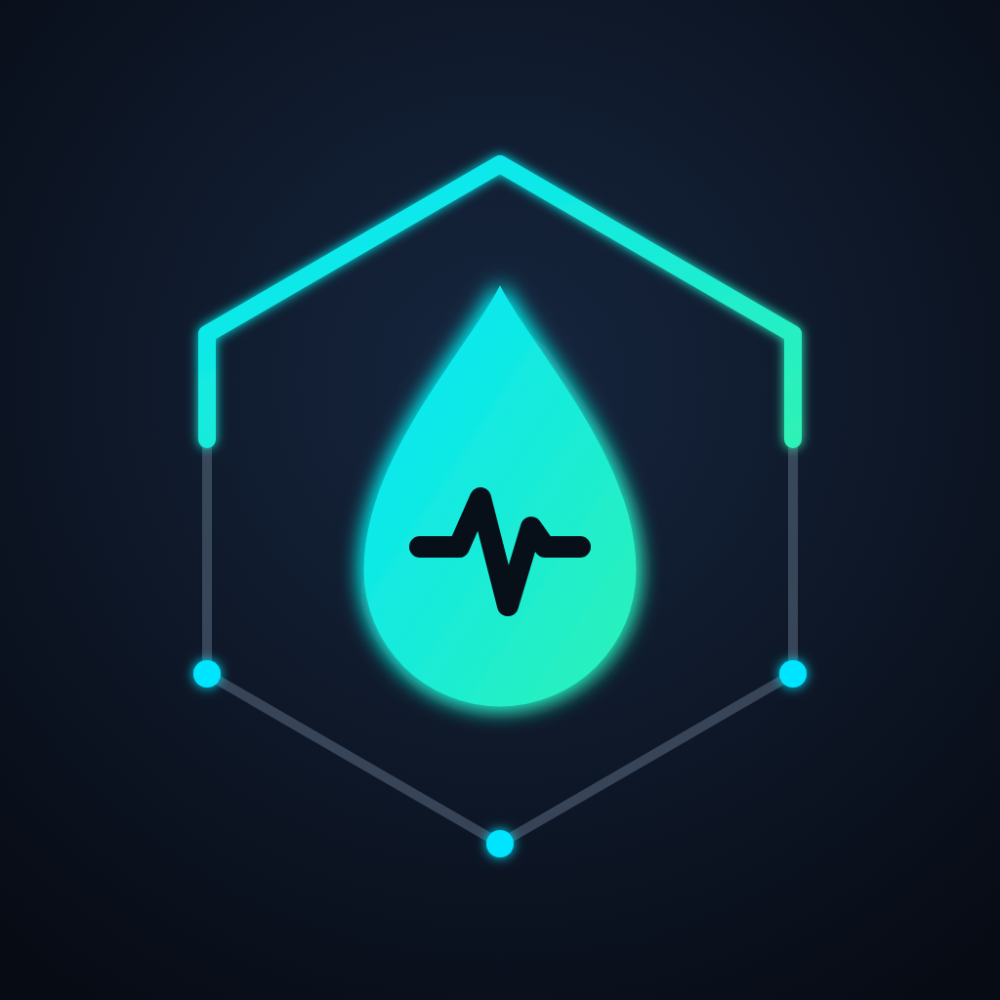
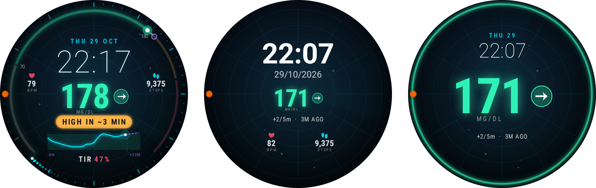
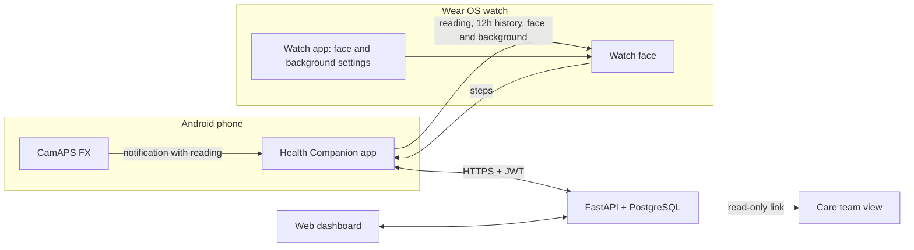

<p align="center">
  
</p>

<h1 align="center">Health Companion</h1>

<p align="center">
  A diabetes companion for Wear OS, Android and the web: CGM readings on your wrist with
  trend arrows and predictive alerts, plus meals, activity, injuries, reports and a care-team view.
</p>

<p align="center">
  <a href="https://github.com/saffist3r/HealthCompanion/releases/tag/v1.9.0">Latest release: v1.9.0</a> ·
  <a href="RELEASES.md">Releases</a> ·
  <a href="CHANGELOG.md">Changelog</a> ·
  <a href="SECURITY.md">Security</a>
</p>



Glucose readings come from **CamAPS FX** notifications on the phone and reach the watch over the Wear OS Data Layer. Everything else (meals, reports, history) lives in **your own** FastAPI + PostgreSQL server; no API key or database credential ever sits on the phone.

> This is a personal project built for one person's day-to-day care. It is not a medical device. Always confirm readings and alerts with your CGM and pump.

---

## What's inside

| Part | Where | What it does |
|------|-------|--------------|
| **Watch face + app** | `apps/watch` (Kotlin) | Three faces (HUD, Classic, Minimal) with the reading, trend arrow, forecast, alerts, heart rate and steps. The watch app holds the face and background settings |
| **Phone app** | `apps/mobile` (Expo / React Native) | Reads CamAPS notifications, syncs the watch, and gives you Today, Glucose, Meals, Reports, Mental, Activity and Settings tabs. Follows the system dark mode |
| **API** | `backend` (FastAPI, PostgreSQL, Alembic) | Accounts, meals with Gemini photo analysis, reports, injuries, pump sync, RAG archive, care-team shares |
| **Web dashboard** | `frontend` (React, Vite) | Dashboard, meals, reports and Understanding, journal (morning, mental, injuries, sports), Life Review, care-team sharing. FR/EN |
| **Shared code** | `packages/shared` (TypeScript) | Notification parsing, units, chart helpers and the CGM trend engine, used by the phone and web |

### Highlights

- **CGM-grade trends.** The watch and the phone use the same engine: a recency-weighted rate over the last ~10 minutes, the Dexcom/Libre arrow bands (⇈ ↑ ↗ → ↘ ↓ ⇊), and a damped 30-minute forecast. The Kotlin engine and its TypeScript port are checked against the same 14 test cases.
- **Predictive alerts.** "LOW IN ~12 MIN" / "HIGH IN ~8 MIN" when the forecast crosses your range within 20 minutes, plus an urgent-low state and a "signal lost" warning after 15 minutes without a reading. The watch vibrates on every new reading below 70 mg/dL and buzzes once when a low is forecast.
- **Meal AI.** Photograph a meal (several photos are fine) and the server estimates carbs, protein and fat and flags diabetes-relevant warnings.
- **Reports and Understanding.** Daily and weekly nutrition, time in range, GMI, activity and injuries, with charts, AI briefs and PDF export.
- **Care team view.** A read-only link for your nurse or doctor (14/30/90-day glucose bands, hypos with the 4 hours before, insulin, carbs, steps, pain, mood, sleep). Links expire and can be turned off.
- **Activity.** Health Connect and Samsung Health (steps, energy, workouts).
- **Voice.** Reb3i Darija voice briefings and hands-free live chat.

---

## Watch faces

| Face | Shows |
|------|-------|
| **HUD** | Log-scale gauge ring with the target band and a 20-minute forecast marker, the reading with its trend badge, 3-hour chart with a 30-minute projection, time in range, heart rate and steps |
| **Classic** | Large time and date, the reading and trend, alerts, heart rate and steps |
| **Minimal** | An oversized reading inside a ring coloured by glucose zone, with only the time and date above it |

**Changing the face.** Pick a face in either place. The most recent pick wins, so the phone's background re-syncs never undo a choice you made on the watch.

- **On the watch:** open **Health Companion**. The app opens on its settings, with **Face** at the top.
- **On the phone:** **Settings → Watch**.

**Animations.** While the screen is on, the faces animate:

- on wake and on each new reading, the gauge sweeps to the value and a ripple pulses out
- a comet runs around the seconds ring
- the heart beats at your measured rate
- the trend arrow nudges in its direction
- the Minimal ring has an orbiting scanner

The number itself is never animated through in-between values, so a quick glance always shows a real reading. Ambient mode stays static.

**Backgrounds.** Choose animated, solid, gradient, or an image slideshow, set the text colour, and turn status tint on or off. You can change these on the phone (Settings → Watch) or in the watch app.

---

## How it works



1. CamAPS FX posts a notification with the reading. The phone app only accepts values with an explicit unit, so bolus and insulin lines are ignored.
2. The phone sends the reading, the last 12 hours of history and your watch settings over the Data Layer. The watch works out the trend, forecast and alerts on its own.
3. The phone app also talks to your API for meals, reports and history. The web dashboard uses the same API.

---

## Getting started

**Prerequisites:**

- Node.js 18 or later and npm 9 or later
- JDK 17 and the Android SDK (Android Studio)
- Python 3.11 and Docker
- an Android phone running CamAPS FX
- a Wear OS watch (tested on Galaxy Watch)

### 1. Install

```bash
git clone https://github.com/saffist3r/HealthCompanion.git
cd HealthCompanion
npm install          # also builds packages/shared and applies patches
```

### 2. API and web dashboard

```bash
cp backend/.env.example backend/.env
# set GEMINI_API_KEY and JWT_SECRET=$(openssl rand -hex 32), see SECURITY.md

docker compose up -d db
cd backend && python3 -m venv .venv && source .venv/bin/activate
pip install -r requirements.txt
uvicorn app.main:app --reload --port 8000   # applies migrations on start
```

```bash
cd frontend && npm install && npm run dev
```

The API runs at http://localhost:8000/docs and the web app at http://localhost:5173. More in [backend/README.md](backend/README.md) and [frontend/README.md](frontend/README.md).

### 3. Phone app

```bash
cd apps/mobile && npx expo run:android
```

Then on the phone:

1. Grant **Notification access**: Settings → Apps → Special app access → Notification access → Health Companion. Without it, no reading reaches the watch.
2. Sign in. On a physical phone, set the server to `http://<your-lan-ip>:8000` or your HTTPS origin.

After changing the app icon, splash, dark mode or native modules, rebuild the native project with `npx expo prebuild` before building.

### 4. Watch app

```bash
cd apps/watch/android && ./gradlew assembleDebug
```

Install it over Wi-Fi. Wear OS 4 and later use wireless debugging:

1. On the watch, open **Settings → Developer options → Wireless debugging → Pair new device**.
2. Pair, connect and install:

```bash
adb pair <watch-ip>:<pairing-port> <code>
```

```bash
adb connect <watch-ip>:<connection-port>
```

```bash
adb install -r app/build/outputs/apk/debug/app-debug.apk
```

`adb mdns services` lists the watch's pairing and connection ports, so you don't have to read them off the screen. [`scripts/install-watch-wifi.sh`](scripts/install-watch-wifi.sh) runs all three steps.

Then open **Health Companion** on the watch once and accept **Body sensors** (heart rate) and **Physical activity** (steps). Long-press the current watch face and select **Health Companion**.

---

## Deploying

Kubernetes manifests and the deploy script are in [`k8s/`](k8s/README.md):

```bash
./k8s/setup-secrets.sh    # creates the gitignored k8s/secrets.yaml
./k8s/deploy.sh
```

Set your hostnames in `k8s/ingress.yaml` and `k8s/configmap.yaml`. Read [SECURITY.md](SECURITY.md) first: never commit `.env`, `k8s/secrets.yaml`, meal photos or database dumps.

---

## Development

```
apps/
  mobile/        Expo app. src/screens, src/components, wearSync.ts (phone → watch),
                 plugins/ (native Wear OS, Samsung Health and Health Connect bridges)
  watch/android/ Wear OS app. HudFaceDrawer.kt and FaceStyles.kt (faces and animations),
                 GlucoseTrendEngine.kt, GlycemiaDataListenerService.kt (Data Layer),
                 SettingsScreen.kt (watch settings)
backend/         FastAPI app, Alembic migrations, pytest suite
frontend/        React + Vite web dashboard
packages/shared/ Shared TypeScript (glucoseTrend.ts, background.ts, sparkline*.ts)
k8s/             Manifests and deploy script
scripts/         Version sync, release build, watch Wi-Fi install
```

| Command | What it does |
|---------|--------------|
| `npm run mobile` / `npm run web` / `npm run api` | Start the phone, web or API dev server |
| `npm test -w @health-companion/shared` | Trend engine tests (TypeScript) |
| `cd apps/watch/android && ./gradlew testDebugUnitTest` | Trend engine tests (Kotlin) |
| `cd backend && pytest -q && ruff check .` | API tests and lint |
| `npx tsc --noEmit -p apps/mobile` | Type-check the phone app |
| `node scripts/sync-version.mjs --check` | Check every version matches `VERSION` |
| `npm run build:release` | Release builds |

CI runs the tests, lint, type-check and version check on every push to `main` and every pull request. It also builds the web app, the watch APK and the Docker images.

---

## Permissions

**Phone:**

- **Notification access** (granted by hand) to read CamAPS readings
- `POST_NOTIFICATIONS` for reminders and nudges
- `RECORD_AUDIO` for voice briefings and live chat
- Health Connect read access for steps, calories, distance, exercise and heart rate
- `ACTIVITY_RECOGNITION`

**Watch:**

- `BODY_SENSORS` for heart rate
- `ACTIVITY_RECOGNITION` for steps

Both are requested when you open the watch app. The face retries sensor registration every 30 seconds, so permissions granted later are picked up.

---

## CamAPS FX compatibility

The phone listens to `com.camdiab.fx_alert.mmoll`, `com.camdiab.fx_alert.mgdl`, `com.camdiab.fx_alert` and `com.camdiab`. A reading must carry an explicit unit (`mmol/L`, `mmol` or `mg/dL`). Implausible values are dropped.

---

## Troubleshooting

**No reading on the watch.**

1. Check that the phone app has Notification access.
2. Check that CamAPS has posted at least one reading.
3. Check that the phone and watch are connected.
4. Open the phone app, which syncs on launch, or tap **Sync to watch** on the glucose card.
5. Opening the watch app also pulls the latest reading.

**"SIGNAL LOST" on the face.** The last reading is more than 15 minutes old, so the trend and forecast are hidden on purpose. Check CamAPS and the phone connection.

**Heart rate or steps show "--".** Open the watch app and accept both permissions, then wait up to 30 seconds. Some devices only update steps while the screen is on.

**The face changed back.** The newest pick wins. If you changed the face on the phone after changing it on the watch, the phone's pick applies.

---

## License

MIT, see [LICENSE](LICENSE). Issues and pull requests are welcome.
